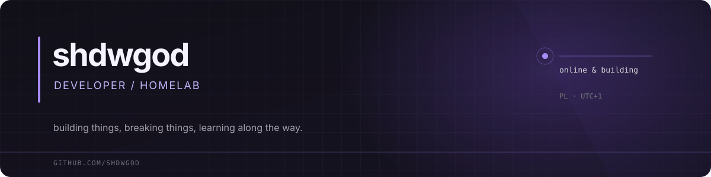

 

&nbsp;

 

## About

I'm shdwgod. I enjoy building web apps, automating everyday tasks, and running services on my own hardware. Usually learning something new, tweaking something, or starting another project.

**Currently into:** web development, Linux, Docker, self-hosting, and all the little things that make a setup feel *just right*.

## Toolbox

## GitHub at a glance

&nbsp;

 

 

  Made with curiosity, caffeine, and too many terminal tabs.

